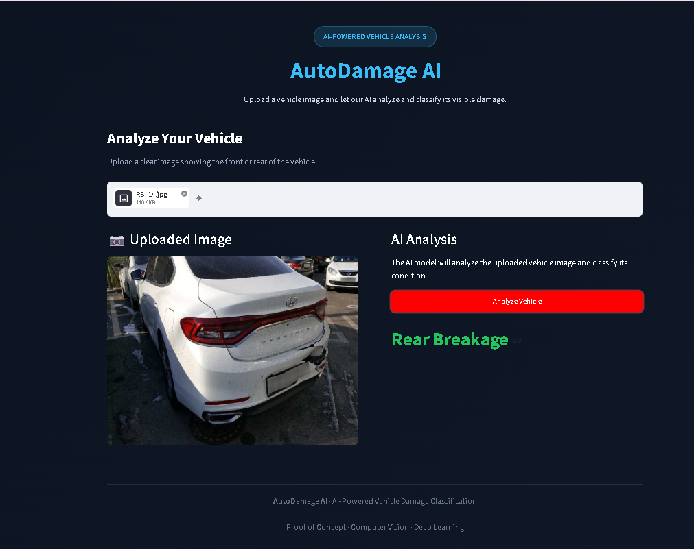
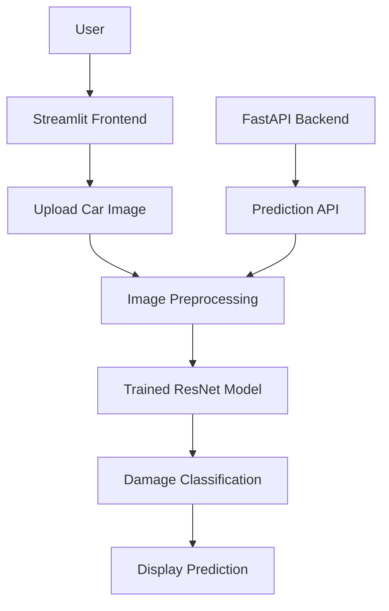

# 🚗 AutoDamage AI
### AI-Powered Vehicle Damage Detection & Classification

AutoDamage AI is a deep learning-based application that classifies vehicle images into six predefined damage categories. Users can upload a car image and receive an AI-generated prediction through an interactive Streamlit interface.

## 📸 Application Preview

<!-- Add your prediction screenshot here -->



## ✨ Features

- Upload vehicle images (JPG, JPEG, PNG).
- Classify front and rear vehicle conditions.
- Six-class damage classification.
- Deep learning with transfer learning.
- Interactive Streamlit frontend.
- FastAPI backend for model inference.

## 🎯 Supported Classes

| Front | Rear |
|---|---|
| Front Normal | Rear Normal |
| Front Breakage | Rear Breakage |
| Front Crushed | Rear Crushed |

## 🧠 Model Development

Experimented with multiple deep learning architectures:

- Simple CNN
- CNN with Regularization
- EfficientNet Transfer Learning
- ResNet Transfer Learning
- Hyperparameter Tuning

**Final Model:** ResNet

**Validation Accuracy:** ~80%

## 🏗️ System Architecture



## 📁 Project Structure

```text
AutoDamage_AI/
│
├── dataset/
├── notebooks/
│   ├── damage_prediction.ipynb
│   └── hyperparameter_tuning.ipynb
│
├── fastapi_server/
│   ├── model/
│   ├── server.py
│   ├── model_helper.py
│   └── requirements.txt
│
├── streamlit_app/
│   ├── model/
│   ├── app.py
│   ├── model_helper.py
│   └── requirements.txt
│
├── .gitignore
└── README.md
```

## 🛠️ Tech Stack

- **Language:** Python
- **Deep Learning:** PyTorch, TorchVision
- **Models:** CNN, EfficientNet, ResNet
- **Frontend:** Streamlit
- **Backend:** FastAPI, Uvicorn
- **Development:** VS Code, Jupyter Notebook

## 🚀 Run Locally

Clone the repository:

```bash
git clone https://github.com/ali-liyakat/AutoDamage_AI.git
cd AutoDamage_AI
```

Create and activate a virtual environment:

```cmd
python -m venv venv
venv\Scripts\activate
```

Install dependencies:

```cmd
pip install -r streamlit_app/requirements.txt
pip install -r fastapi_server/requirements.txt
```

Run the Streamlit application:

```cmd
cd streamlit_app
streamlit run app.py
```

Run the FastAPI server in a separate terminal:

```cmd
cd fastapi_server
uvicorn server:app --reload
```

## 🔮 Future Improvements

- Damage localization and severity estimation.
- Prediction confidence scores.
- Support for multiple vehicle images.
- Improved model accuracy and generalization.
- Cloud deployment and scalable API integration.

---

**Developed by Liyakat Ali Joo**

*AutoDamage AI — Making Vehicle Damage Assessment Smarter with AI.*